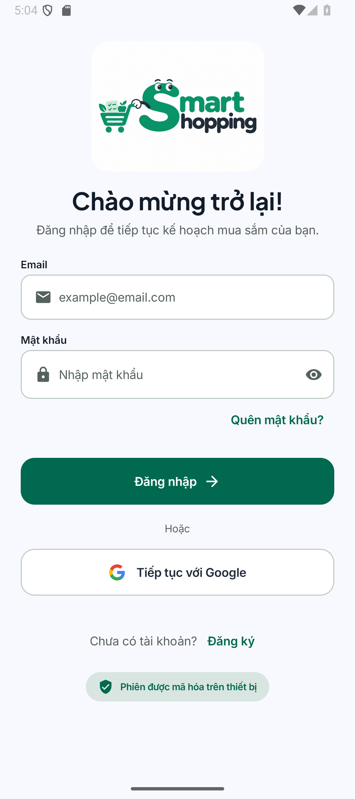
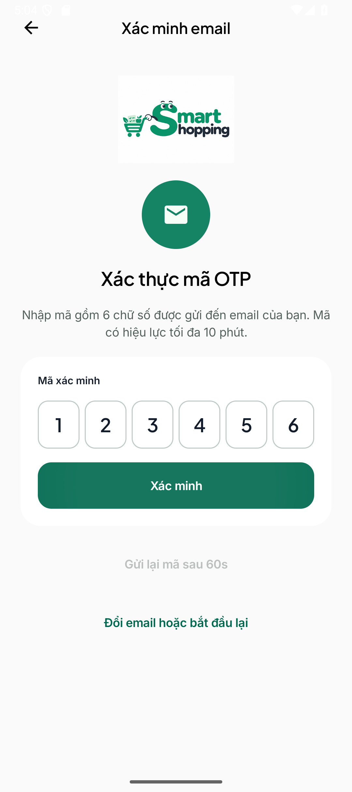
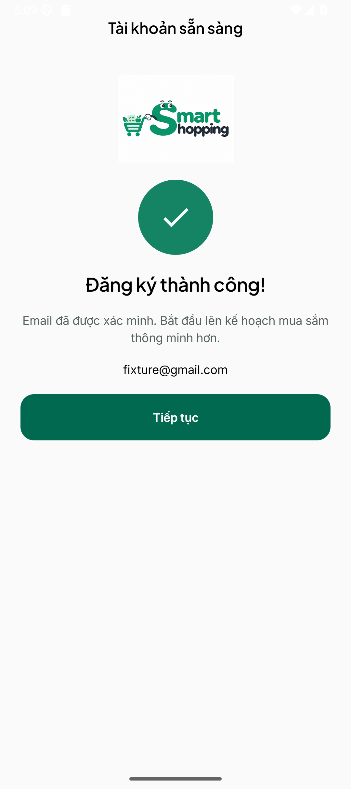

# AUTH-01/02 — phạm vi và bằng chứng

Ứng dụng có đăng ký Gmail qua OTP, đăng nhập mật khẩu/Google, liên kết Google với tài khoản hiện có, quên mật khẩu và quản lý phiên. Các màn hình dùng thiết kế Stitch đã lưu của dự án. Phạm vi yêu cầu: US/UC/FR-01–02; API-AUTH-01–16 dưới `/api/v1`. Profile chỉ có default/onboarding entry; chỉnh hồ sơ và Home nghiệp vụ thuộc task tiếp theo.

## Hành vi và tương thích

- Đăng ký trả `202` challenge, chưa cấp token hoặc tạo User/Profile; xác minh thành công mới hoàn tất. Login trả `202` khi tài khoản chưa xác minh, `200` khi đã xác minh.
- Mật khẩu tạo/reset dài 10–128 ký tự, có hoa/thường/ký tự đặc biệt; password cũ vẫn dùng được để login. Đăng ký mới chỉ nhận gmail.com; tài khoản cũ ngoài Gmail vẫn xác minh và sử dụng được.
- OTP sáu số, 10 phút, tối đa năm lần sai, gửi lại sau 60 giây. Mã và quyền reset chỉ dùng một lần; gửi lại không xóa số lần sai. Backend bảo vệ OTP bằng HMAC, không lưu mã rõ.
- Google được kiểm tra chữ ký/audience/issuer/expiry/nonce; dùng sub làm định danh. Trùng email local yêu cầu mật khẩu hiện tại trước khi liên kết. Reset password thu hồi toàn bộ phiên.
- Migration V3 giữ User/Profile, thêm challenge/Google identity và email_verified_at, cho phép password null cho Google-only; thu hồi các phiên cũ để yêu cầu xác minh email. V1/V2 không thay đổi.
- Debug SDK 36 gọi `10.0.2.2:8080` từ Android Emulator, không cần adb reverse. Release yêu cầu HTTPS. Integration tests phải đặt smartShoppingDebugApiBaseUrl và authIntegrationBaseUrl cùng URL fixture riêng.

## Kiểm chứng đã ghi nhận

| Mốc | Kết quả |
|---|---|
| Backend, 18/10/2026 | 34 tests trên PostgreSQL tạm 55432; 0 failure/skip |
| Postman/Newman, 18/10/2026 | 27 collection requests, 76 assertions; 0 failure |
| Android đầy đủ, 18/10/2026 | 44 unit và 22 device tests, 0 failure/skip; bốn luồng live qua fixture HTTP/PostgreSQL riêng |
| Android/network, 19/10/2026 | 46 unit, build debug/AndroidTest; 2 device network checks đạt, 0 failure/skip trên Pixel_9a Android 15/API 35 |
| Emulator không reverse, 19/10/2026 | GET /me không bearer từ Android qua 10.0.2.2 trả 401 AUTH_REQUIRED, không truy cập database |
| Nghiệm thu thực tế, 19/10/2026 | Người dùng xác nhận tổng thể AUTH hoàn tất sau khi tự cấu hình/chạy/test local |

Các số device ở hai mốc là những lượt kiểm tra khác nhau, không phải một full suite 24 tests. Backend tự động dùng fake mail/Google identity; verifier có test RSA/certificate giả lập. Agent không tự dùng Gmail/Google thật hoặc đọc mật khẩu ứng dụng; xác nhận của người dùng không thay cho log từng kịch bản thật. Không reset database development, không gửi thư hàng loạt.

## Ảnh giao diện

Ảnh từ UI fixture, có mã/email giả lập; không phải tài khoản hoặc OTP thật.

| Đăng nhập | Xác minh email | Thành công |
|---|---|---|
|  |  |  |

## Chạy local và giới hạn

Xem [Frontend](../../README.md), [backend](../../../backend/README.md) và [cấu hình Google/Gmail](../../../backend/AUTH_SETUP.md). Gmail SMTP dùng phát triển; hosting/HTTPS và gửi thư production chưa triển khai. Thông tin bí mật chỉ nhập local qua script DPAPI, không đưa vào Git hoặc APK. Postman collection chỉ chia sẻ cấu trúc/giá trị test, không export biến chứa token/password thật.
